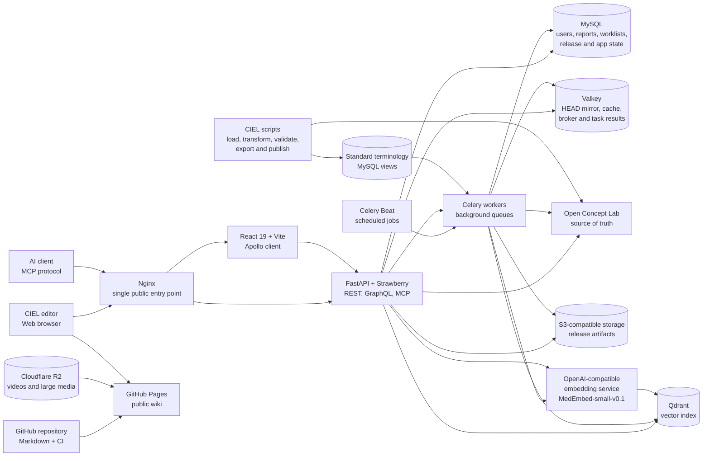

# System architecture

CIEL Lab separates interactive review from slow ingestion and indexing work.
The browser talks to a single web entry point; the API coordinates OCL, cached
data, relational state, background jobs, and semantic search.

## Infrastructure infographic

## Request path

The React application uses Apollo for GraphQL operations and calls supporting
API routes where appropriate. Nginx presents the web application, API, and MCP
surfaces under one deployment. MySQL stores durable application state:
accounts, reports, worklists, and release records.

OCL is authoritative for terminology content. CIEL Lab does not make Qdrant or
Valkey authoritative. It uses them as optimized projections:

- **Valkey HEAD mirror** supplies a fast snapshot of current CIEL HEAD content.
  The application can fall back to live OCL reads when the mirror is not
  available.
- **Qdrant vector index** supports semantic retrieval over CIEL and indexed
  external terminologies.
- **MySQL terminology views** expose a consistent shape for loaders such as
  SNOMED CT, ICD-11, and RxNorm.

## Embeddings and semantic search

The embedding adapter speaks an OpenAI-compatible API and defaults to
`abhinand/MedEmbed-small-v0.1`. CIEL Lab stores the resulting vectors in the
shared Qdrant collection `ciellab_medembed_small`.

Each vector carries filterable payload metadata, including terminology system,
version, code, and CIEL environment. This lets one collection support:

- semantic CIEL searches;
- exact-code lookup;
- version or terminology constraints;
- on-demand external terminology indexes.

Indexing uses stable point identifiers, batched embedding calls, and batched
Qdrant upserts. Re-running a job updates existing points instead of creating
duplicates.

!!! warning "Semantic similarity is not clinical equivalence"

    Vector ranking can prefer a broad lexical match over a clinically specific
    code. Treat results as candidates. Confirm the terminology, version,
    status, and intended meaning before applying a mapping. This limitation is
    especially important for post-coordinated or highly specific expressions.

## Background jobs

Fast user interactions should not wait for a complete OCL refresh, terminology
index, bulk report, or release artifact. The API therefore dispatches work to
Celery through Valkey.

The worker task families include:

| Task family | What it does |
| --- | --- |
| CIEL HEAD refresh | Pulls OCL HEAD, rebuilds the mirror, then updates related projections |
| Vector indexing | Embeds and indexes CIEL or an external terminology in Qdrant |
| Dashboard refresh | Recomputes summary metrics and trends |
| Staged-change refresh | Builds the HEAD-to-release change model |
| Bulk validation | Executes deterministic QA rules and persists a report |
| Worklist hydration | Resolves or enriches external terminology candidates |
| Translation import | Parses model output and creates a reviewable translation batch |
| OCL apply | Applies approved concept or mapping changes with user authorization |
| Release artifacts | Produces SQL and Markdown diff artifacts and can publish Liquibase Runner output |
| Retention | Deletes expired reports and related temporary state |

Celery Beat schedules the regular refresh chain. In the observed configuration,
CIEL HEAD refresh and indexing begin at **00:00 UTC**, and the dashboard refresh
begins at **04:00 UTC**. Manual refresh actions can enqueue the same expensive
work outside that schedule.

## Refresh versus reload

These words are intentionally different:

- **Reload** reads the latest state already held by CIEL Lab.
- **Refresh** contacts OCL and may rebuild cache, indexes, and derived data.

A refresh can take much longer. Use it only when the source of truth changed
and the scheduled update cannot be awaited.

## Reliability boundaries

- OCL is the terminology source of truth.
- MySQL is the durable application record.
- Worklists are durable review checkpoints and should survive a moving HEAD
  snapshot.
- Valkey and Qdrant can be rebuilt.
- A cache reset can temporarily make QA or search look incomplete until the
  refresh/index chain finishes.
- MCP tools prepare previews; the human-facing app performs the final commit.
