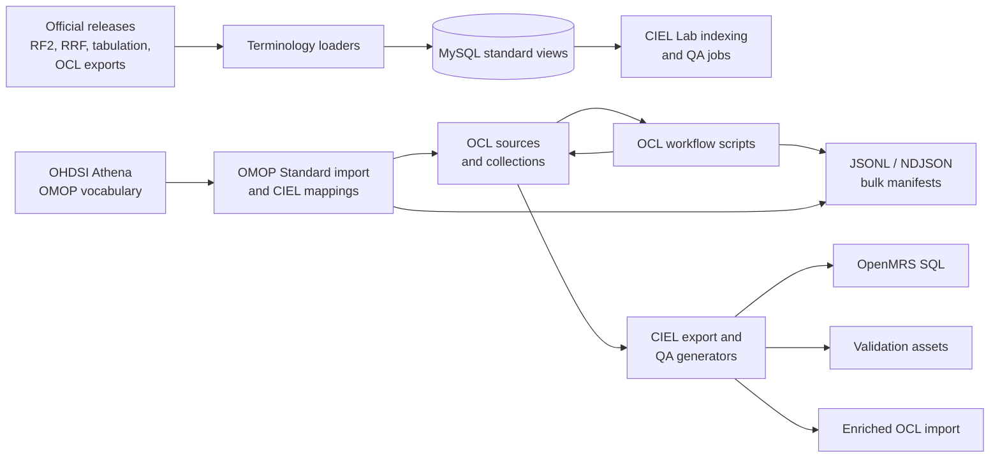

# CIEL scripts

`ciel-scripts` is the operational companion to the CIEL Lab application. It
contains one-purpose programs for loading external terminologies, preparing OCL
bulk imports, checking ICD-11 and IMO mappings, generating release artifacts,
and testing exports.

It is a toolbox, not a second web application.

## Where it fits

CIEL Lab consumes standardized terminology data and derived assets. The scripts
produce or maintain those inputs:



## Standard loader contract

The terminology loaders materialize a common database interface:

- `vw_code_name_active` — active code and display information;
- `vw_retired_code_replacement` — retired codes and known replacement
  metadata;
- terminology metadata tables and views.

CIEL Lab can use the common shape without embedding each source format into its
application logic.

## Environment

Create a virtual environment in the scripts repository and install its own
`requirements.txt`. Loader connections use:

```bash
export FLOW_DB_HOST="127.0.0.1"
export FLOW_DB_PORT="3306"
export FLOW_DB_USER="root"
export FLOW_DB_PASS="..."
```

Most OCL scripts accept:

```bash
export OCL_API_URL="https://api.openconceptlab.org"
export OCL_API_TOKEN="..."
export OCL_ORG_ID="..."
```

Read the selected script's `--help` and README section before execution.
Credential names are not completely uniform in this historical toolbox:
`ocl_loader.py`, for example, expects `OCL_API_KEY`.

!!! danger "Mutating scripts"

    A script with `delete`, `recreate`, `upload`, `apply`, or `publish` in its
    workflow may alter remote OCL or GitHub state. Generate an artifact or use
    dry-run mode first, inspect the target environment, and make sure a recovery
    path exists.

## Suggested operator sequence

1. Identify the exact source release and checksum.
2. Load it into a disposable or named local database.
3. inspect the standardized views.
4. Run source-specific QA.
5. Generate a manifest or artifact without applying it.
6. review counts and representative rows.
7. Apply to the intended staging environment.
8. verify OCL and CIEL Lab projections.
9. Repeat the reviewed process for production.

## RxNorm Extension

The separate [RxNorm Extension workflow](ocl-workflows.md#rxnorm-extension-subset)
prepares a CIEL-related subset from Athena and a CIEL export, plus reviewable
source and Mapper collection artifacts. It does not require the OMOP Standard
PostgreSQL staging database. Review the artifacts and source permissions before
any manual import.

## OMOP Standard and IMO comparison

The OMOP workflow stages an OHDSI Athena vocabulary in a disposable local
PostgreSQL database, then prepares two reviewable OCL bulk-import JSONL files:
the `OHDSI/OMOP-Standard` concept subset and CIEL-to-OMOP Standard mappings.
Use `setup_omop_postgres.sh` for the local staging database and
`ocl_omop_standard_import.py` to generate the files. It writes to OCL only
when an explicit upload option is used; inspect both artifacts and their report
first.

`compare_imo_mappings_to_ciel.py` is a read-only companion for comparing IMO
ProblemIT or ProcedureIT mapping tables with a CIEL export. It produces a
machine-readable CSV, curator XLSX, and JSON summary. Review differences before
creating or changing mappings in either system.
