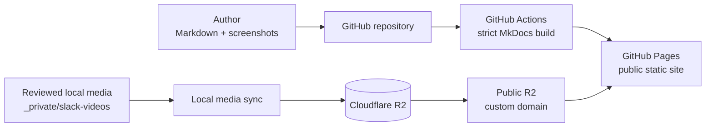

# GitHub Pages and R2

The production topology uses GitHub Pages for the generated documentation and
Cloudflare R2 for reviewed videos.

## Deployment behavior

A push to `main` runs `.github/workflows/github-pages.yml`. The workflow:

1. Installs the pinned Material for MkDocs dependency.
2. Builds the documentation with strict validation.
3. Uploads the generated `site/` directory as a Pages artifact.
4. Publishes that artifact through the protected `github-pages` environment.

GitHub's own short-lived identity token authorizes deployment. The workflow does
not require a long-lived Pages secret.

## Build variables

| GitHub Actions variable | Purpose | Required |
| --- | --- | --- |
| `SITE_URL` | Canonical GitHub Pages or custom-domain URL | Recommended |
| `R2_PUBLIC_BASE_URL` | Public R2 custom domain, without a trailing slash | Optional |

If `SITE_URL` is absent, the workflow uses
`https://openconceptlab.github.io/ciellab-wiki/`.

If `R2_PUBLIC_BASE_URL` is absent, the wiki still builds and publishes. Each
video position shows:

> The video could not be loaded. The media file or Cloudflare R2 configuration
> may be unavailable.

The same message appears at runtime when a configured R2 object returns an
error.

## Public media

The Pages artifact contains written documentation and reviewed screenshots.
Videos remain outside Git and are loaded from the R2 custom domain.

Use a public custom domain for production media. The `r2.dev` URL is suitable
for testing but is rate limited. Configure an R2 CORS policy that permits
`GET` requests from the GitHub Pages origin and any final custom wiki domain.

## Full installation

Follow the repository-level `INSTALL.md` to:

- enable GitHub Pages with GitHub Actions;
- create repository variables;
- create and expose the R2 bucket;
- create bucket-scoped S3 credentials;
- upload media;
- verify both successful video playback and the unavailable-video fallback.
