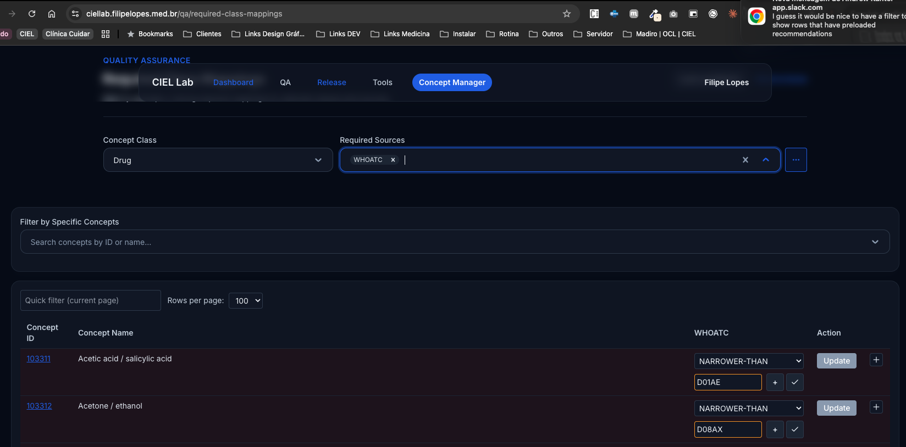

# Required Class Mappings

Use this page to find CIEL concepts that are expected to map to a target
terminology but currently do not.

{ .ciellab-screenshot }

## How the query works

The query combines:

- one or more CIEL concept classes;
- the target mapping source;
- the selected CIEL source/version;
- the absence of an acceptable mapping.

Class and mapping-source filters are dynamic. Selecting the exact class matters:
a general diagnosis review and a drug review should not share the same required
target sources.

## Review missing mappings

1. Select the CIEL version or HEAD.
2. Choose the concept class.
3. Choose the required mapping source.
4. Run the search.
5. Open a result and review its current names and mappings.
6. Load candidate codes.
7. verify the candidate in the external terminology.
8. Save the approved mapping.
9. rerun the query to confirm that the concept no longer appears.

Candidate suggestions are aids, not authoritative replacements. If the expected
code does not appear, use [Code Search](../tools/code-search.md) and enter the
mapping manually.

## Multiple mappings and partial edits

Some concepts legitimately need more than one mapping. Review the semantic
relationship and map type instead of assuming the first candidate replaces all
existing mappings.

The editor supports partial work: save the change that is known, leave
unresolved candidates for a later worklist, and rerun the check against current
HEAD.

## Common causes of an unexpected result

- the concept class is broader or narrower than assumed;
- the target source is not required for that class;
- an existing mapping uses a different source identifier;
- HEAD cache or the external index is still rebuilding;
- the desired target is post-coordinated and cannot be represented as a single
  indexed code.

