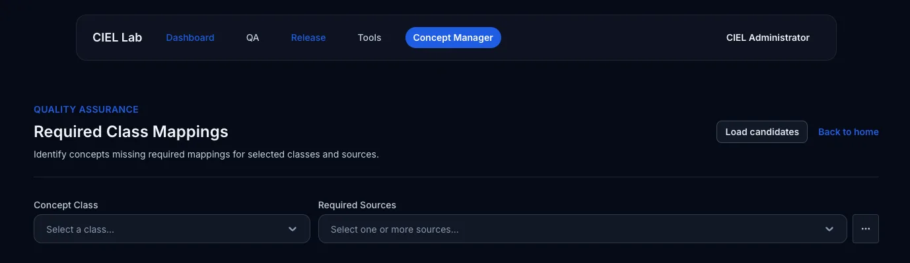
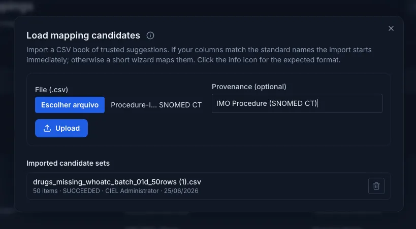
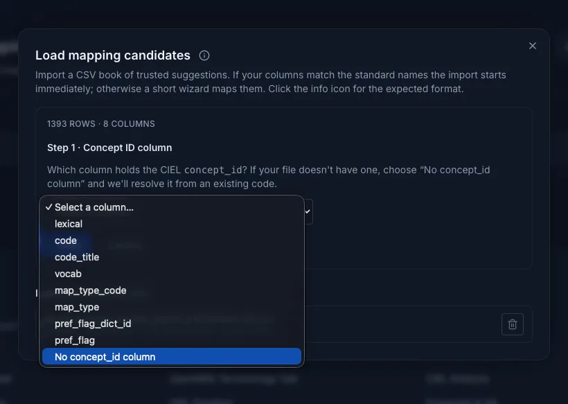
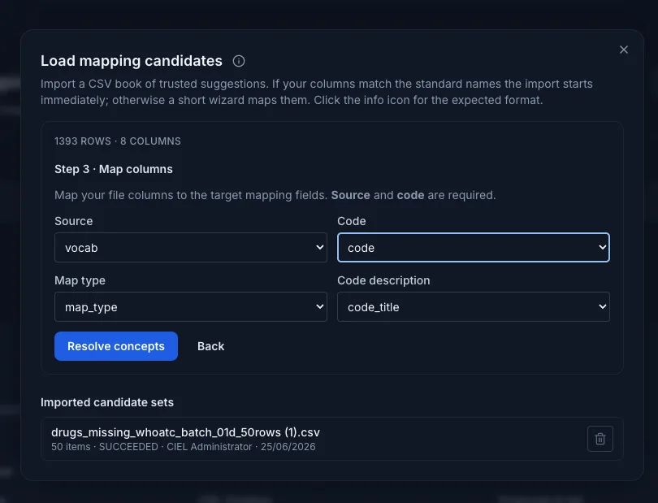
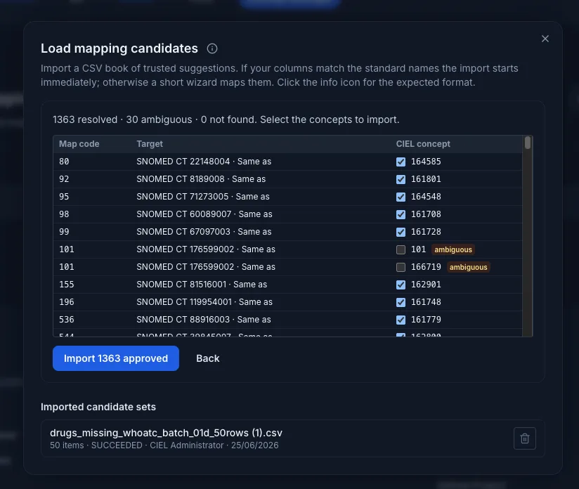
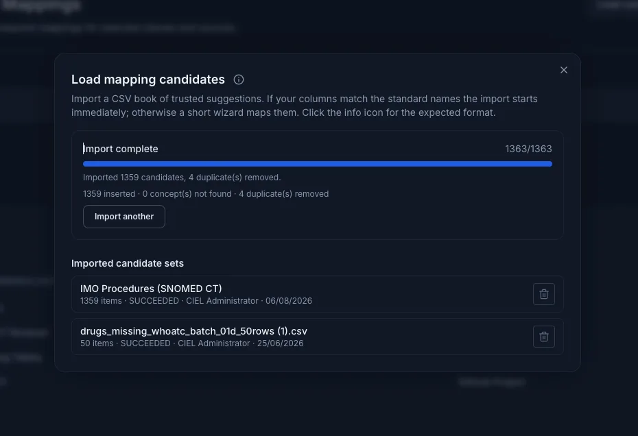

# Required Class Mappings

Use this page to find CIEL concepts that are expected to map to a target
terminology but currently do not, then review trusted mapping suggestions before
writing an approved mapping to OCL.

{ .ciellab-screenshot }

The candidate import is a review aid: importing a file does **not** create or
change an OCL mapping. A curator must still review the concept, candidate,
mapping relationship, and target terminology before saving the mapping.

## Before you start

- Have access to **Quality Assurance** and the CIEL version or HEAD that you
  intend to review.
- Prepare a trusted `.csv` file. The importer accepts comma- or
  semicolon-separated CSV files.
- Know the target terminology source for each suggestion and, when using a Map
  ID, the source of the *existing* mapping used to identify the CIEL concept.
- Use current HEAD data for Map ID resolution. This lookup uses the local HEAD
  mapping index, not a live terminology search.

## Prepare the candidate file

The fastest import uses these standard column names:

| Column | Required | Meaning |
| --- | --- | --- |
| `concept_id` | No | CIEL concept identifier. Omit it only when you will identify the concept by Map ID. |
| `source` | Yes | Target source of the proposed mapping, such as `SNOMED-CT` or `LOINC`. |
| `code` | Yes | Proposed target code in that source. |
| `map_type` | No | Proposed relationship, such as `SAME-AS` or `NARROWER-THAN`. |
| `code_description` | No | Readable description of the proposed code. |

When the file contains exactly `concept_id`, `source`, and `code`, the import
starts immediately. For different headers, the import wizard lets you map file
columns to the fields above or select one fixed target source for every row.

## Choose the identity check

The importer supports two distinct ways to identify the CIEL concept. Choose
the one that matches the evidence in the candidate file.

| Check | What the file identifies | Best use | Review required |
| --- | --- | --- | --- |
| **Concept ID** | The CIEL concept directly, through `concept_id`. | A CIEL worklist, export, or curated file that already records the CIEL concept ID. | Confirm that the ID still represents the intended CIEL concept and that the proposed target mapping is correct. |
| **Map ID** | A CIEL concept indirectly, through the code and source of one of its existing mappings. | Curated candidates from another terminology that preserves CIEL mappings as mapping references. For example, use this for an IMO Procedures dataset that carries a reference mapping code rather than a CIEL concept ID. | Review the resolved CIEL concept. Resolve or exclude ambiguous matches; do not assume the first result is correct. |

In both modes, `source` and `code` describe the **proposed target mapping**. In
Map ID mode, **Map ID column** and **Map ID source** instead identify the
already-existing CIEL mapping used as the reference lookup. They can therefore
be different from the proposed target source and code.

## Load a candidate set

1. Open **Quality Assurance** > **Required Class Mappings** and select
   **Load candidates**.
2. Select the `.csv` file. Optionally enter a clear **Provenance** value, for
   example `IMO Procedures (SNOMED CT)`, so later reviewers can identify the
   curated set.
3. Select **Upload**.

{ .ciellab-screenshot }

4. If the file uses the standard headers, wait for the import to complete. If
   not, complete the short wizard described below.

### Concept ID path

1. In **Step 1 · Concept ID column**, select the file column holding the CIEL
   ID.
2. In **Step 3 · Map columns**, select the proposed mapping's **Source** and
   **Code**. Optionally select **Map type** and **Code description**.
3. Select **Import** and wait for **Import complete**.

Use this path when the file's CIEL identity has already been verified. It does
not perform a reverse mapping lookup.

### Map ID path

1. In **Step 1 · Concept ID column**, select **No concept_id column**.

{ .ciellab-screenshot }

2. In **Step 2 · Map ID lookup**, select the **Map ID column** and the **Map ID
   source**. These are the existing mapping reference, not the proposed target.
3. In **Step 3 · Map columns**, map the proposed target's **Source** and
   **Code**; add **Map type** and **Code description** when supplied.
4. Select **Resolve concepts**.

{ .ciellab-screenshot }

5. Review the resolution table. Single matches are preselected. For every row
   marked **ambiguous**, inspect each listed CIEL concept and select only the
   intended one. Rows marked **not found** are not imported.
6. Select **Import _n_ approved**.

{ .ciellab-screenshot }

This explicit approval step makes Map ID suitable for the IMO workflow: an
external dataset can contribute curated mapping suggestions without allowing an
indirect reference code to silently choose a CIEL concept.

## Verify the import and apply a mapping

The progress panel reports inserted candidates, concepts not found, and
duplicates removed. The saved set remains visible under **Imported candidate
sets** with its provenance and status.

{ .ciellab-screenshot }

Then use the candidates in the normal required-mapping review:

1. Select the CIEL version or HEAD, the **Concept Class**, and the required
   target source or sources.
2. Run the query and open a result.
3. Review the concept's current names and mappings, then inspect its candidate
   code in the authoritative external terminology.
4. Confirm the target source, code, and map type; save only the approved OCL
   mapping.
5. Rerun the query to confirm the concept no longer appears as missing the
   required mapping.

Candidate suggestions are aids, not authoritative replacements. If the desired
target does not appear, use [Code Search](../tools/code-search.md) and enter a
manually verified mapping.

## Read mapping status correctly

The page distinguishes a missing required mapping from other mappings that are
shown for context. **Other mappings** excludes mappings that are retired,
system-managed, or not eligible for this review. When an external code is
available, its displayed status can also show that the external term is
inactive. Treat that status as a prompt to verify the source terminology, not
as authorization to replace a mapping automatically.

In the Concept Manager, direct mappings are shown separately from inverse
relationships. A relationship that points *to* the current concept must not be
read as a mapping owned by that concept. Confirm the source, direction, code,
and map type before accepting or changing any candidate.

## Multiple mappings, limits, and recovery

Some concepts legitimately need more than one mapping. Review the semantic
relationship and map type instead of assuming the first candidate replaces all
existing mappings. You can save known changes and leave unresolved candidates
for a later worklist.

- The import accepts CSV only. Correct a file with missing required values or
  an unrecognized target source, then upload it again.
- Map ID resolution is limited to 5,000 rows per interactive lookup. Split a
  larger file into reviewed batches.
- A missing or unexpected Map ID result can mean that the chosen reference
  source is wrong, the mapping is absent from the HEAD index, or more than one
  CIEL concept has that reference mapping. Refresh or verify the current CIEL
  mapping before retrying.
- Duplicate candidate rows are removed during import. Deleting an imported
  candidate set removes the review suggestions, not OCL mappings that a
  curator already saved.

## Related

- [Bulk Validation](bulk-validation.md)
- [Code Search](../tools/code-search.md)
- [Issue #2608 — IMO procedure mapping workflow](https://github.com/OpenConceptLab/ocl_issues/issues/2608)
