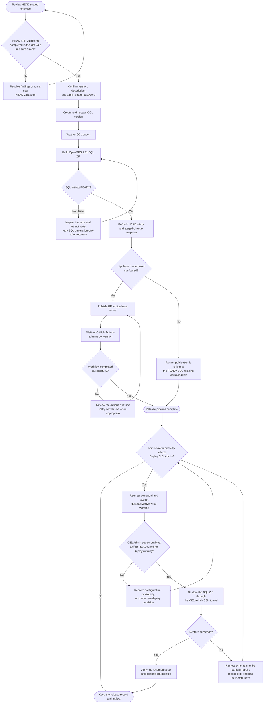
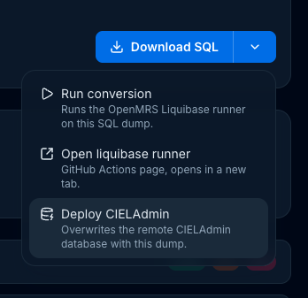

# Release workflow

The Release page coordinates the transition from a changing CIEL HEAD to a
reviewed release and its downstream artifacts.

{ .ciellab-screenshot }

## Before starting

Confirm all of the following:

- the intended OCL source is selected;
- HEAD refresh and derived indexes have completed;
- the latest Bulk Validation report targets HEAD;
- the report is less than 24 hours old and has zero errors;
- active worklists have been reviewed or explicitly deferred;
- a database and OCL recovery plan exists for the release operation.

## Understand the comparison

The page compares HEAD with the latest released version and groups changes such
as:

- concepts created, updated, removed, or retired;
- names, descriptions, and translations changed;
- mappings created, updated, removed, or retired.

The displayed comparison is derived state. **Reload** reads the current cached
comparison. **Refresh** pulls a newer OCL HEAD and may rebuild the cache and
index before the diff becomes available.

## Create a release

1. Reload and review the full staged-change summary.
2. Drill into every unexpected category.
3. resolve or document outstanding QA findings.
4. Confirm the release identifier and description.
5. Start release creation.
6. Keep browser notifications enabled if you want completion feedback while
   working elsewhere.
7. Verify the newly created OCL version.
8. Generate and inspect downstream artifacts.

## Release sequence and decision points

The release page records the pipeline below as a stepper. It is the source of
truth for the current run; browser notifications only mirror step changes.

The optional CIELAdmin branch is never started automatically. A successful
release therefore does not imply that the legacy CIELAdmin database was
overwritten.

## Artifacts

Background tasks can produce:

- a Markdown change report;
- an OpenMRS-compatible SQL artifact;
- Liquibase Runner publication output;
- supporting downloads stored in S3-compatible object storage.

Artifact generation can outlive the browser request. Use task state and the
artifact record instead of assuming a closed browser canceled the job.

### SQL artifact actions

When the SQL artifact is **READY**, **Download SQL** is the primary action. Its
adjacent menu contains the operational follow-ups shown below.

{ .ciellab-screenshot }

*The SQL artifact action menu on the [Release workflow](release-workflow.md)
page. Administrative actions are hidden for non-administrators.*

- **Run conversion** publishes the stored SQL ZIP to the Liquibase runner and
  starts its GitHub Actions conversion. It is the recovery path when automatic
  publication was skipped because the server token was absent, an upload failed,
  or schema versions must be regenerated. It does not create another OCL
  release or rebuild the SQL artifact.
- **Open liquibase runner** opens the runner's GitHub Actions page. Check it
  before starting another conversion: the runner uses one shared input ZIP, so
  a conversion already queued or running for another version can be overwritten.
  A prior run for the same version changes the action label to **Retry
  conversion**.
- **Deploy CIELAdmin** is a separate, admin-only action. It restores this exact
  SQL ZIP into the legacy CIELAdmin OpenMRS database. The dialog requires the
  operator's own password and explicitly warns that concept tables are dropped
  and rebuilt. Direct edits made there since the prior deployment are lost.

CIELAdmin deployment is available only when the server enables it, object
storage can supply the READY artifact, and no other CIELAdmin deployment is
running. It deliberately has no reachability preflight; the background task
retries a transient tunnel connection, while a SQL error or timeout stops for
human inspection. A failed restore can leave the remote schema partially
rebuilt, so inspect the recorded task error and server logs before deliberately
starting it again.

## Track the release pipeline

After a release begins, the page shows a stepper for the tracked job. Each
stage is marked pending, running, successful, or failed, and completed stages
can link to their recorded workflow run. This is the authoritative progress
view for the release; browser notifications are supplementary.

Set them up in [Settings → Release pipeline updates](https://ciellab.filipelopes.med.br/settings).
Select **Enable notifications** and allow the browser permission prompt. When
enabled, the browser can notify you as each release stage completes even if the
Release page is closed. Use **Turn off** to remove the current browser
subscription. For the full setup, permissions, and recovery instructions, see
[Settings and access](settings.md#release-pipeline-updates).

### Which release events notify you?

Notifications go only to the signed-in user who started the release or manually
restarted a release action. A successful completed step sends a notification
headed `Release <version>`; its text is the recorded step result. A failed step
sends `Release <version> — failed` and includes the failed-step label plus a
short error message.

| Release event | Browser notification |
| --- | --- |
| **Create & release version**, **Generate OCL export**, **Build OpenMRS SQL dump**, or **Refresh HEAD & staged changes** completes | Yes — one completion notification per step |
| **Publish to liquibaserunner** or **Generate schema versions (GitHub Actions)** completes | Yes — one completion notification per step, including the recorded runner outcome/link context when available |
| Admin manually starts and completes **Deploy CIELAdmin** | Yes — the completion message includes the restored target and, when available, the resulting concept count |
| Any tracked release step fails | Yes — one failure notification; inspect the Release stepper for the full error and recovery state |
| A step is skipped, including unconfigured Liquibase publication or the optional CIELAdmin branch that was not selected | No — skipped steps do not produce a browser notification |
| A step starts or reports in-progress progress | No browser push; follow it in the Release stepper |

Clicking a notification returns to the Release page. The stepper remains
authoritative because push delivery is best effort: an unavailable browser,
missing server VAPID configuration, revoked subscription, or denied site
permission must never stop the release pipeline.

For generated SQL artifacts, wait for the status to become ready before using
**Download SQL**. If generation fails, preserve the error, confirm the release
version and upstream job state, then use **Retry** only after the cause is
understood. Administrators control SQL artifact generation and the two
downstream actions described above.

## Failure recovery

If the release job fails:

1. do not start a second release immediately;
2. inspect whether OCL already created a partial or complete version;
3. inspect the background task and artifact logs;
4. preserve the failed run record;
5. restore or retry only after the actual external state is known.

For a failed CIELAdmin deployment, treat the database as potentially partial
until the task log and database state confirm otherwise. The only rollback path
is a backup of that remote server; the release workflow does not create one.

Release operations are intentionally conservative. A clean diff and current QA
report are more valuable than speed.
