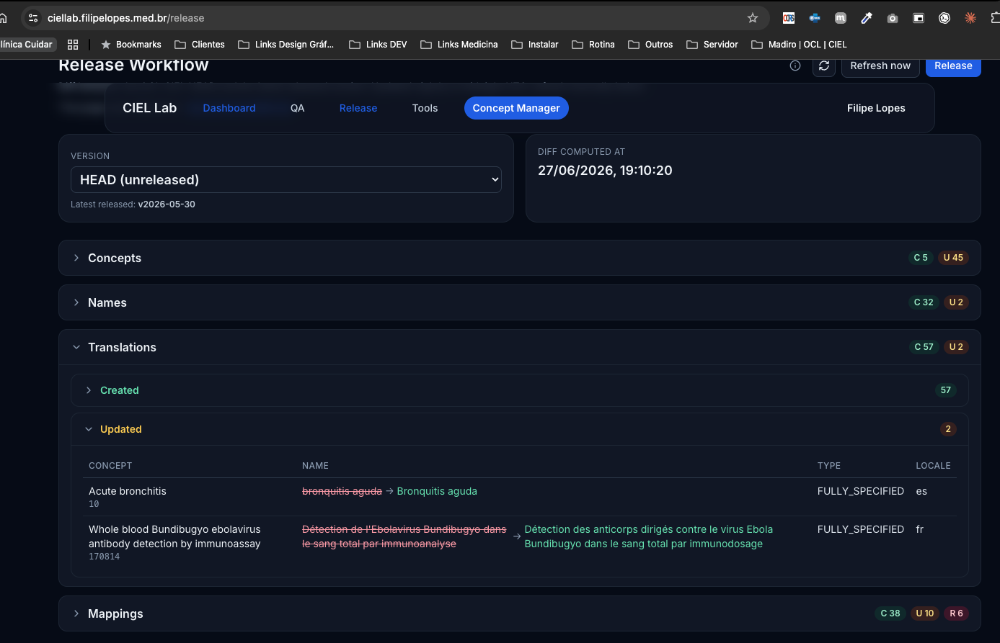

# Release workflow

The Release page coordinates the transition from a changing CIEL HEAD to a
reviewed release and its downstream artifacts.

{ .ciellab-screenshot }

## Before starting

Confirm all of the following:

- the intended OCL source is selected;
- HEAD refresh and derived indexes have completed;
- the latest Bulk Validation report targets HEAD;
- the report is less than 24 hours old and has zero errors;
- active worklists have been reviewed or explicitly deferred;
- a database and OCL recovery plan exists for the release operation.

## Understand the comparison

The page compares HEAD with the latest released version and groups changes such
as:

- concepts created, updated, removed, or retired;
- names, descriptions, and translations changed;
- mappings created, updated, removed, or retired.

The displayed comparison is derived state. **Reload** reads the current cached
comparison. **Refresh** pulls a newer OCL HEAD and may rebuild the cache and
index before the diff becomes available.

## Create a release

1. Reload and review the full staged-change summary.
2. Drill into every unexpected category.
3. resolve or document outstanding QA findings.
4. Confirm the release identifier and description.
5. Start release creation.
6. Keep browser notifications enabled if you want completion feedback while
   working elsewhere.
7. Verify the newly created OCL version.
8. Generate and inspect downstream artifacts.

## Artifacts

Background tasks can produce:

- a Markdown change report;
- an OpenMRS-compatible SQL artifact;
- Liquibase Runner publication output;
- supporting downloads stored in S3-compatible object storage.

Artifact generation can outlive the browser request. Use task state and the
artifact record instead of assuming a closed browser canceled the job.

## Failure recovery

If the release job fails:

1. do not start a second release immediately;
2. inspect whether OCL already created a partial or complete version;
3. inspect the background task and artifact logs;
4. preserve the failed run record;
5. restore or retry only after the actual external state is known.

Release operations are intentionally conservative. A clean diff and current QA
report are more valuable than speed.

