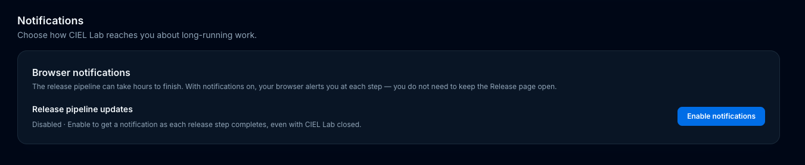
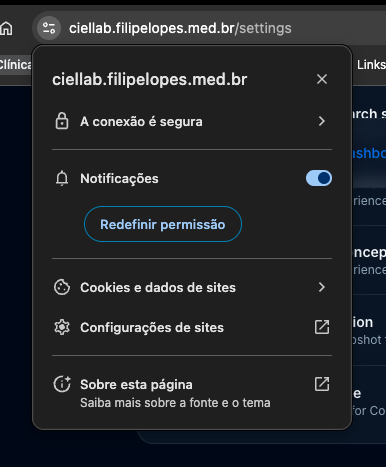

# Settings and access

Settings controls personal preferences and credentials. The public wiki is
separate from the protected CIEL Lab application.

## Search defaults

Choose a default search mode and CIEL version. Enable semantic suggestions when
discovery is more important than exact matching; use textual or exact-code mode
for reproducible lookups.

## Release pipeline updates

Open [Settings → Release pipeline updates](https://ciellab.filipelopes.med.br/settings),
then select **Enable notifications** and approve the browser prompt. This is
the account-level setup for release notifications; it is not a setting that must
be repeated for every release.

{ .ciellab-screenshot }

*The notification setting in the protected CIEL Lab application. It is tied to
this browser and this site origin.*

The subscription receives a browser notification when a tracked release step
completes and when one fails. It does not notify for skipped or merely
in-progress steps. See [which release events notify you?](release-workflow.md#which-release-events-notify-you)
for the exact event list and message types.

The choice is per browser and per site, not per release. It continues to work
while CIEL Lab is closed when the browser and its service worker can receive
push messages.

Use **Turn off** to remove that browser subscription. A denied browser
permission must be changed in the browser's site settings before the feature
can be enabled again. The release page remains the source of truth for job
status and errors.

### Recover a blocked browser permission

If the page says **Blocked**, allow notifications for
`ciellab.filipelopes.med.br` in the browser's site controls, then reload
[Settings](https://ciellab.filipelopes.med.br/settings) and select **Enable
notifications** again. The exact menu varies by browser; in Chrome, open the
site controls beside the address bar and change **Notifications** to allow.

{ .ciellab-screenshot }

*Chrome example: browser-level permission is separate from the CIEL Lab
subscription.*

If the card says **Unavailable**, use a current Chrome, Edge, Firefox, or
Safari and ask an administrator to confirm that the server's Web Push (VAPID)
configuration is enabled. The release itself continues even when a notification
cannot be delivered.

## Personal OCL token

CIEL Lab stores each user's OCL token encrypted and uses it for authorized OCL
operations. This preserves the OCL audit identity and avoids a shared
application-wide editor credential.

After changing the token, perform a read and a harmless authorized check before
a release-critical session.

## CIEL Lab personal access tokens

Personal access tokens beginning with the application's configured prefix are
intended for MCP clients. They are shown once, should be stored in a secret
manager or client secret field, and can be revoked independently.

## Password and account administration

Users can change their password in Settings. Administrators approve accounts
and manage user state in **Admin → Users**.

## Public documentation

The GitHub Pages wiki is public and does not use Cloudflare Access. Private
evidence, raw Slack exports, and unreviewed media remain excluded from Git and
R2 publication.
