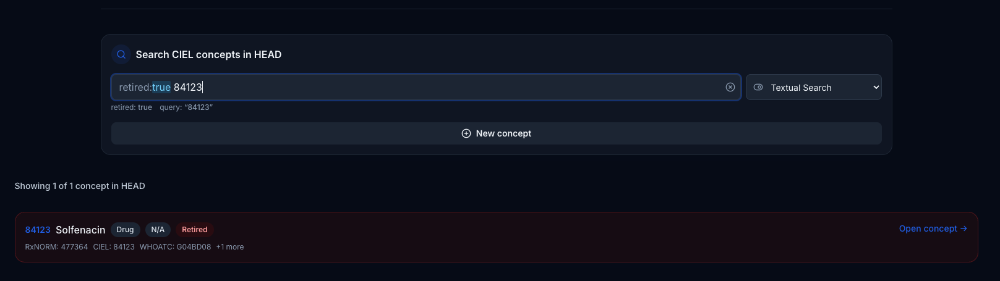
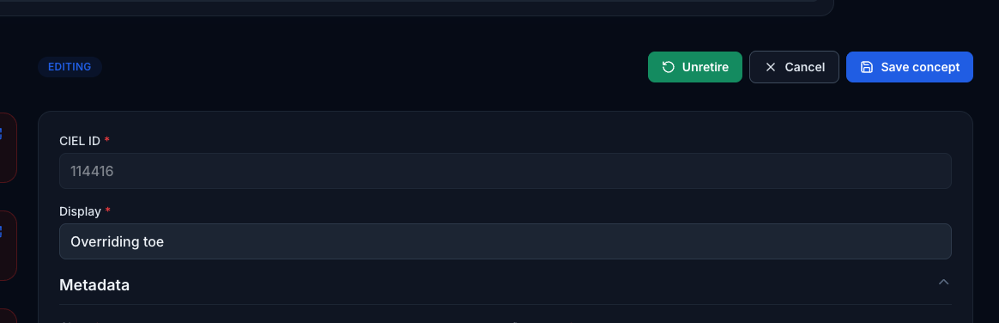

# Concept Manager

Concept Manager is the primary workspace for finding and changing CIEL
concepts. It searches the current snapshot, presents names and mappings
together, and supports controlled edits.

{ .ciellab-screenshot }

## Find a concept

1. Choose HEAD or a fixed CIEL version.
2. Search by code, name, or description.
3. Select textual or semantic search.
4. Add concept-class, clinical-status, or other available filters. Use
   `clinical:false` to find explicitly non-clinical concepts; concepts without
   that marker are clinical by default.
5. Unqualified text and index searches return active concepts by default. Add
   `retired:true` when the historical record is intentionally part of the task.
6. Open the result and verify the concept identifier before editing.

**Textual search** is predictable for known terms and codes. **Semantic search**
is useful when wording differs, but its score is only a retrieval signal.

For a non-empty **Index Search** query with no explicit column sort, results are
ordered by relevance. Selecting an ID, name, class, or datatype sort keeps that
column order; a blank query uses ID order. Relevance improves the order of the
same matched set and does not turn a semantic suggestion into clinical proof.

## Inspect the concept

Review these elements together:

- concept class and datatype;
- fully specified and preferred names;
- synonyms, locale, and name type;
- descriptions;
- active and retired status;
- clinical status;
- direct mappings;
- reverse associations or references;
- current source/version.

An apparently missing mapping may be represented in another direction or under
a different source identifier. Inspect the complete mapping context.

### Open a Concept Quick View

Use **Option/Alt+click** on a `CIEL:<id>` reference to inspect a concept without
leaving the current workflow. **Alt+Enter** provides the same action from the
keyboard. A normal click keeps its normal destination, and Cmd/Ctrl-click or a
middle click still opens the link in a tab.

The popover reads the local HEAD mirror and shows the concept name, class,
datatype, retired status, and units where available. Select **View more** to
reveal mappings. Mapping rows appear immediately; a human-readable external
code name is an optional enhancement and may arrive later.

If the popover says that the concept was not found in the local HEAD mirror,
refresh the CIEL snapshot or use the normal link to check the authoritative OCL
record. Quick View does not substitute a live OCL request for the mirror.

## Edit safely

1. Open the concept from a fresh search.
2. Change the smallest necessary field.
3. Review form validation.
4. Confirm mapping source, code, and map type.
5. Save once.
6. Reload or search for the concept again.
7. Confirm the persisted state from the server.

Avoid repeated clicks while a save is pending. The UI stages and refreshes
several projections, so the item may not instantly appear in every search
surface.

## Restore a retired concept

Use **Unretire** only to correct a retirement that should not remain in the
source. It makes the concept active again and clears its retirement reason; it
does not merge the concept or alter its names and mappings.

1. In Concept Manager, search HEAD with `retired:true` and the concept ID.
2. Open the retired result and select **Edit**.
3. Select **Unretire** in the action bar, then confirm **Unretire** in the
   dialog.
4. Wait for the success message, then reload the concept and confirm that the
   **Retired** badge is gone.
5. Make any needed mapping or merge correction as a separate, reviewed action.

{ .ciellab-screenshot }

{ .ciellab-screenshot }

If OCL rejects the restore, CIEL Lab reverts its local state and shows the
actionable OCL validation reason when one is available. Do not assume the
concept was restored until a fresh server read shows it active.

### Mapping drafts and QA feedback

Keep an incomplete mapping row as a draft until its required identity fields are
known. CIEL Lab does not present a partially entered mapping as a completed
mapping QA finding, and it preserves the in-progress draft while related QA
state refreshes. Complete the source, target code, and map type before treating
validation feedback as the result for that mapping.

For an existing mapping, verify its stable mapping identifier as well as the
source, code, and relationship. The identifier distinguishes otherwise similar
mappings in searches, review tables, and bulk-edit previews; a new proposed
mapping has no identifier until OCL creates it.

The same safeguard applies to names. A newly added blank name row remains form
input only: changing its locale or type does not start QA or add it to the save
payload. Once it has text, it becomes part of the draft and normal validation
begins. Clearing an existing or previously admitted active name is not an
implicit deletion; **Names require text** blocks Save until the curator restores
text or removes that name deliberately.

## Create or copy

Use **Create** for a new meaning. Use **Copy** only when an existing concept is a
legitimate structural starting point. Before saving a copy:

- replace the identifying names and descriptions;
- remove inherited mappings that do not apply;
- verify class and datatype;
- make sure the concept is not already present under a synonym.

## Merge a duplicate concept

Use **Merge concept** only when two active CIEL concepts represent the same
meaning and one must become the surviving record. The concept currently open is
the one that will be retired; select the concept to keep with care. This action
uses your personal OCL token, so configure it in **Settings** first.

1. Open the duplicate concept and select **Merge concept**.
2. In **Concept to keep**, search for and select the active surviving concept.
3. Review the preview. It identifies the concept to be retired, the concept to
   be kept, active names that will be copied as synonyms, duplicates that will
   be skipped, and the `REPLACED BY` relationship to be created.
4. Select **Merge concept** to queue the operation. Keep the dialog open until
   the result is reported.
5. Search for both identifiers again. Verify that the source is retired with
   the reason `Dupe of <target ID>`, that the target remains active, and that
   the `REPLACED BY` mapping points from source to target.

The operation never overwrites names already on the target. Active source names
not already present are copied as non-preferred synonyms; fully specified names
are also converted to synonyms. A source that is already retired, a retired
target, an existing equivalent `REPLACED BY` mapping, or a concurrent merge is
rejected before the background job begins.

### Recover from a failed merge

Do not retry immediately. Inspect the job result and the current OCL state for
both concepts. If a later write fails, CIEL Lab compensates completed writes
where possible. A `rollback_failed` result means that manual review is required
before any further merge attempt. In particular, preserve the error details and
confirm names, mappings, and retirement state in OCL before proceeding.

If OCL rejects every name that the merge would copy, CIEL Lab aborts before
creating the `REPLACED BY` mapping or retiring the source. Correct the rejected
names or choose a suitable target, then create a new preview. A single rejected
name can be skipped only when other planned copied names succeed.

## Worklists and bulk edits

Worklists group concepts that require review and preserve progress while HEAD
changes. A worklist can feed a bulk-edit preview, but every proposed mutation
still requires human review and authorization.

When a concept was opened from a saved worklist, the action bar also includes a
**Resolved** / **Unresolved** control. It starts from the worklist item's saved
status. The first edit changes it to **Resolved**; you can switch it back to
**Unresolved** before saving when the finding still needs attention. The
control is not shown outside a saved-worklist context.

For a QA finding that relates multiple concepts, opening the finding can load a
temporary worklist containing all related concepts. Use it to compare entries
or preselect a merge target; it is local to the current browser session and is
not a saved worklist.

## Short demonstrations

### Save a concept

  <video class="ciellab-video" controls preload="metadata">
    <source src="{{ R2_PUBLIC_BASE_URL }}/videos/2026-01-15-concept-save.webm" type="video/webm">
    Your browser does not support embedded WebM video.
  </video>
  

    The video could not be loaded. The media file or Cloudflare R2 configuration may be unavailable.
  

### Find it after saving

  <video class="ciellab-video" controls preload="metadata">
    <source src="{{ R2_PUBLIC_BASE_URL }}/videos/2026-01-15-concept-search-after-save.webm" type="video/webm">
    Your browser does not support embedded WebM video.
  </video>
  

    The video could not be loaded. The media file or Cloudflare R2 configuration may be unavailable.
  

The video files live in R2. Their descriptions are indexed by wiki search; the
spoken content is not indexed until a transcript is added.
