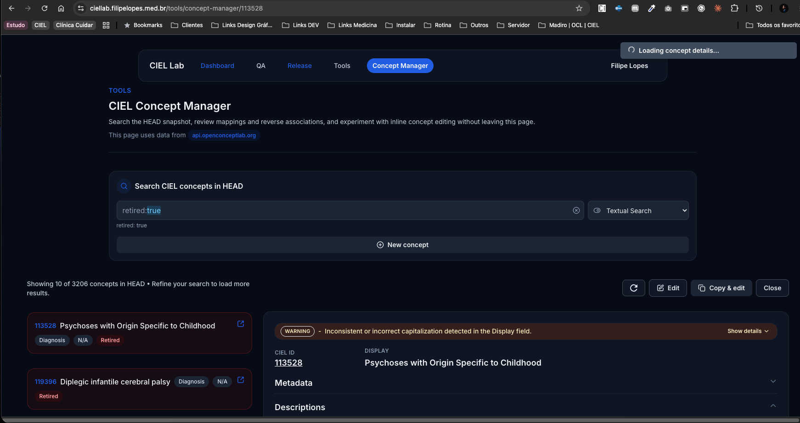

# Concept Manager

Concept Manager is the primary workspace for finding and changing CIEL
concepts. It searches the current snapshot, presents names and mappings
together, and supports controlled edits.

{ .ciellab-screenshot }

## Find a concept

1. Choose HEAD or a fixed CIEL version.
2. Search by code, name, or description.
3. Select textual or semantic search.
4. Add concept-class or other available filters.
5. Open the result and verify the concept identifier before editing.

**Textual search** is predictable for known terms and codes. **Semantic search**
is useful when wording differs, but its score is only a retrieval signal.

## Inspect the concept

Review these elements together:

- concept class and datatype;
- fully specified and preferred names;
- synonyms, locale, and name type;
- descriptions;
- active and retired status;
- direct mappings;
- reverse associations or references;
- current source/version.

An apparently missing mapping may be represented in another direction or under
a different source identifier. Inspect the complete mapping context.

## Edit safely

1. Open the concept from a fresh search.
2. Change the smallest necessary field.
3. Review form validation.
4. Confirm mapping source, code, and map type.
5. Save once.
6. Reload or search for the concept again.
7. Confirm the persisted state from the server.

Avoid repeated clicks while a save is pending. The UI stages and refreshes
several projections, so the item may not instantly appear in every search
surface.

## Create or copy

Use **Create** for a new meaning. Use **Copy** only when an existing concept is a
legitimate structural starting point. Before saving a copy:

- replace the identifying names and descriptions;
- remove inherited mappings that do not apply;
- verify class and datatype;
- make sure the concept is not already present under a synonym.

## Worklists and bulk edits

Worklists group concepts that require review and preserve progress while HEAD
changes. A worklist can feed a bulk-edit preview, but every proposed mutation
still requires human review and authorization.

## Short demonstrations

### Save a concept

  <video class="ciellab-video" controls preload="metadata">
    <source src="{{ R2_PUBLIC_BASE_URL }}/videos/2026-01-15-concept-save.webm" type="video/webm">
    Your browser does not support embedded WebM video.
  </video>
  

    The video could not be loaded. The media file or Cloudflare R2 configuration may be unavailable.
  

### Find it after saving

  <video class="ciellab-video" controls preload="metadata">
    <source src="{{ R2_PUBLIC_BASE_URL }}/videos/2026-01-15-concept-search-after-save.webm" type="video/webm">
    Your browser does not support embedded WebM video.
  </video>
  

    The video could not be loaded. The media file or Cloudflare R2 configuration may be unavailable.
  

The video files live in R2. Their descriptions are indexed by wiki search; the
spoken content is not indexed until a transcript is added.
